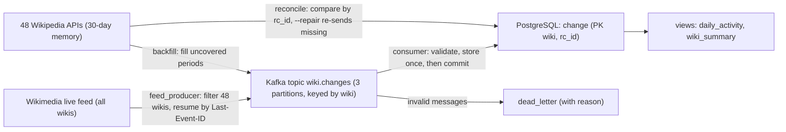

# Live Activity Across African-Language Wikipedias

A streaming pipeline that captures every change made to the **48 open Wikipedias written in African languages**: Hausa, Swahili, Yoruba, Igbo, Zulu, Amharic, Igala, Fula and 40 more. It stores each change **exactly once** in PostgreSQL, whichever of two sources delivered it, and checks the result change by change against Wikipedia's own record.

Wikipedia is one of the largest sources of text in many African languages, and language technology (speech, translation, language models) depends on that text. Whether a language's Wikipedia is growing, stalled, or mostly written by bots matters to its community and to anyone building tools for it. This project measures that continuously and with checked correctness.

**At a glance** (14 October 2026):

| | |
|---|---|
| Wikipedias followed | 48 open (of 49 found; Akan's is closed, Ga has none yet) |
| Changes stored | 212,043, covering 14 September to 14 October 2026 |
| Kafka messages | 212,062 = 212,043 stored + 19 duplicates + 0 dead letters |
| Reconciliation with Wikipedia (random sample of 59 Wikipedia-hours) | 34,639 listed by Wikipedia, 34,639 stored, 0 missing, 0 extra |
| Reconciliation of live-feed sessions (96 Wikipedia-windows) | 0 missing; 3 extra, all explained (a page Wikipedia deleted 19 minutes after creation) |
| Pipeline checks (producers ↔ Kafka ↔ database) | 5 of 5 pass |
| Automated tests | 11 pass |

## Why two sources

Wikimedia publishes every change to every wiki as one public live feed ([EventStreams](https://www.mediawiki.org/wiki/API:Recent_changes_stream)). Measuring it first decided the design:

- The full feed is about **23 events a second, or 0.13 GB an hour**, for all languages. Our 48 Wikipedias are **0.024%** of it.
- Together they make only **a few changes a minute**.
- Listening around the clock would cost about **3 GB a day** of data to keep almost none of it.
- Each Wikipedia's own API lists its recent changes for **about 30 days** (measured: 29.7 to 30.0 days on all 8 checked), and asking for only our Wikipedias costs almost nothing.

So the pipeline has **two producers writing to one Kafka topic**:

- **Live feed:** real time, used when the feed producer is running. A dropped connection is resumed from the last event with `Last-Event-ID`, so nothing is skipped or repeated.
- **API backfill:** finds every period no feed session covered and fetches it from each Wikipedia's API. Each filled window is recorded per Wikipedia, so nothing is fetched twice and a failed Wikipedia is retried next time.

Both convert changes into one **common shape**. The same change arriving from both sources is therefore identical (tested on a real Swahili edit), and the database's primary key `(wiki, rc_id)` stores it once.

With this design, the volume is small enough that the hard problem is not throughput but **correctness**: never losing, duplicating or miscounting a change, through crashes, restarts and outages.

## Architecture



## How correctness is guaranteed

| Risk | Defence | Evidence from real runs |
|---|---|---|
| Claiming a period is covered when it isn't | The feed producer advances `feed_session.ended_at` only after Kafka confirms every message up to that point (`acks=all`). The backfill records a window only after Kafka confirms it. | Tested with Kafka down: coverage did not advance and the run was marked failed |
| A dropped feed connection | Reconnect with the last event's `Last-Event-ID`, with backoff | One real drop during a 30-minute run, resumed with no gap or repeat |
| Duplicates (two sources, retries, replays) | Idempotent producer; primary key `(wiki, rc_id)`; `ON CONFLICT DO NOTHING` with the duplicates counted | 19 real duplicates (5 from both sources, 14 at feed-session edges), each stored once |
| A consumer crash mid-batch | The batch is saved in one transaction **before** the Kafka offset is committed (at-least-once delivery plus idempotent writes means each change is stored exactly once) | Simulated crash: the batch was re-read and counted as duplicates, nothing lost |
| Bad messages | Validation (JSON, known wiki, ID, type, source, time zone); failures go to `dead_letter` with reason and Kafka position | 0 in real data; 8 kinds of bad message tested |
| Test events in the feed | Wikimedia "canary" events are skipped and counted | 2 real canary events skipped |
| Changes the feed missed | Reconciliation against each Wikipedia's API by `rc_id`; `--repair` re-sends missing changes | 0 missing in all checks |
| Silent miscounting anywhere | `check.py` compares producer reports, Kafka offsets, the consume log and stored rows; `consume_log` has a CHECK that inserted + duplicates + dead letters = messages | 212,062 sent = 212,062 in Kafka = 212,062 logged; 0 unread |

## What the data shows

### Activity is bursty, so one day misleads

On one day in Step 1, the 48 Wikipedias made 2,959 changes. Over 29 days they averaged about **7,300 a day**. Two Wikipedias dominate the difference:
- **Hausa:** 55,552 changes in 29 days, against 619 on the snapshot day.
- **Standard Moroccan Tamazight:** 46,643, against 14.

Bot shares moved too. On the snapshot day, Igbo and Yoruba looked 86 to 87% bot-made; over 28 days they are about 46 to 48%.

### Who does the work (last 28 complete days)

"Actions" are edits and new pages. Categorisation events are side effects of edits, and log entries are admin actions, so both are counted separately.

| Wikipedia | Actions | Made by bots | Human editors | Human-written new pages | Top editor's share of human work |
|---|---|---|---|---|---|
| Hausa | 29,405 | 19% | 280 | 7,339 | 10% |
| Standard Moroccan Tamazight | 19,261 | 99% | 27 | 13 | 17% |
| Afrikaans | 10,661 | 31% | 236 | 1,005 | 16% |
| Swahili | 10,332 | 34% | 198 | 4,029 | 16% |
| Fula | 5,459 | 5% | 47 | 1,071 | 76% |
| Igbo | 4,662 | 48% | 102 | 171 | 30% |
| Kinyarwanda | 4,361 | 7% | 51 | 333 | 85% |
| Zulu | 2,269 | 6% | 112 | 511 | 20% |
| Somali | 2,132 | 14% | 94 | 1,289 | 86% |
| Yoruba | 2,105 | 46% | 65 | 514 | 34% |
| Tumbuka | 1,239 | 34% | 23 | 321 | 84% |
| Igala | 642 | 0% | 29 | 86 | 50% |

- **Hausa has the largest and broadest human community.** 280 people wrote 7,339 new pages, and no one person does more than 10% of the work.
- **Standard Moroccan Tamazight's activity is almost entirely automated** (99% by bots).
- **Fula, Kinyarwanda, Somali and Tumbuka each rely on one volunteer for 76 to 86% of all human work.** Their activity would largely stop if that one person did.
- **Igala, a Nigerian language with a young Wikipedia,** has 29 human editors and no bot activity.
- **18 of the 48 Wikipedias had no changes at all** on the snapshot day in Step 1.

### The feed and the API do not record the same thing

During a 30-minute feed session, the reconciliation found 3 changes we stored that Wikipedia no longer lists. They were the creation of a promotional article on Afrikaans Wikipedia and its two categorisations. Afrikaans Wikipedia's deletion log shows an administrator deleted the article **19 minutes after it was created**, with the reason "previously deleted; marketing".

Wikipedia removes a deleted page's entries from its list of recent changes. So:
- **The live feed records changes as they happen.**
- **The API shows what survives.**

Periods filled from the API can never include pages deleted in the meantime (spam, promotion, vandalism). The pipeline keeps what it captured, and the reconciliation reports exactly where and why the two differ. Over longer feed sessions, this "extra" count would measure how much quickly-deleted content each Wikipedia attracts and how fast it is removed.

## Data model

| Table | Holds |
|---|---|
| `wiki` | The 48 open Wikipedias (plus closed Akan, stored but not followed) |
| `change` | One row per change. **Event time** (`changed_at`, when it was made) is kept separate from **processing time** (`stored_at`), so a change backfilled tomorrow still counts on the day it happened. The row also records its first source and exact Kafka position. |
| `feed_session` | Periods the live feed covered, advanced only after Kafka confirms |
| `backfill_window` | Periods the backfill fetched, per Wikipedia |
| `consume_log` | Every consumer batch: inserted, duplicates and dead letters, forced by a CHECK to add up |
| `dead_letter` | Messages that could not be stored, with the reason; keyed by Kafka position, so a replay never stores one twice |
| `reconcile_result` | Every comparison with Wikipedia's record: missing, extra, repaired |
| `pipeline_run` | Every run of every program, with its status and counts |
| `daily_activity`, `wiki_summary` (views) | Activity per Wikipedia per day, and the 28-day summary above |

Schema changes are applied as numbered migrations (`sql/02_…`, `sql/03_…`), never by wiping data.

## Limitations

- **"Bot" means an account Wikipedia has flagged as a bot.** Automated accounts without the flag are counted as human, so bot shares are minimums.
- **Most stored data came from the API backfill.** The live feed ran for about 35 minutes in total, because of the data cost. Those backfilled periods cannot contain changes to pages deleted before the backfill ran, as described above.
- **One Kafka broker with replication factor 1,** fine for one machine but not fault-tolerant. A production cluster would use 3 brokers and replication factor 3.
- **Kafka has no storage volume.** Its messages survive `docker compose stop` but not `down`. PostgreSQL is the permanent record, and anything Kafka loses can be re-fetched from the APIs within 30 days.
- **Partitions are uneven** (one holds about 60% of messages), because messages are keyed by Wikipedia to keep each one's changes in order, and the two busiest share a partition.
- **The API's 30-day memory** means the pipeline must run at least monthly, or older gaps become unrecoverable. The backfill looks back 29 days.
- **Usernames are public on Wikipedia and are stored,** but results are reported only in aggregate. No individual is named or ranked.

## How to run

You need Docker Desktop and Python 3.11 or later. No API keys are needed.

```bash
cp .env.example .env                       # then choose a database password in .env
docker compose up -d                       # Kafka 3.9 (KRaft) and PostgreSQL 16; wait about 30 s for Kafka
docker compose exec kafka /opt/kafka/bin/kafka-topics.sh --bootstrap-server localhost:9092 --create --topic wiki.changes --partitions 3 --replication-factor 1
python -m pip install -r requirements.txt

python -m pipeline.feed_producer --minutes 30   # optional: follow the live feed (about 0.13 GB an hour)
python -m pipeline.run_all                      # backfill gaps, store, reconcile and repair, store repairs, check
python -m pytest -v                             # 11 tests, about 1 second, no Kafka or database needed
```

The exploration behind every design decision is in `notebooks/01_explore_sources.ipynb`.

## Repository layout

```
notebooks/01_explore_sources.ipynb   which Wikipedias exist, their activity, feed cost and lag, API memory, common shape
pipeline/common.py                   database, Kafka producer settings, the common shape of a change
pipeline/feed_producer.py            live feed to Kafka, with checkpoints and resume
pipeline/backfill.py                 finds uncovered periods per Wikipedia and fills them from the APIs
pipeline/consumer.py                 Kafka to PostgreSQL: validate, store once, dead letters, then commit
pipeline/reconcile.py                compares with Wikipedia's record by rc_id; --repair re-sends missing changes
pipeline/check.py                    producers vs Kafka vs consume log vs stored rows
pipeline/run_all.py                  the routine run in one command
sql/01_schema.sql                    tables and constraints
sql/02_backfill_window.sql           migration: backfill windows
sql/03_reconcile_and_views.sql       migration: reconciliation results and analysis views
tests/test_pipeline.py               11 tests
```

## Data source

Changes come from Wikimedia's [EventStreams](https://stream.wikimedia.org/v2/stream/recentchange) feed and each Wikipedia's [MediaWiki API](https://www.mediawiki.org/wiki/API:RecentChanges). Every request identifies the project with a descriptive User-Agent, as Wikimedia's policy asks, and API calls are made one at a time with pauses. Wikipedia content and metadata are available under the licences stated by the Wikimedia Foundation.
